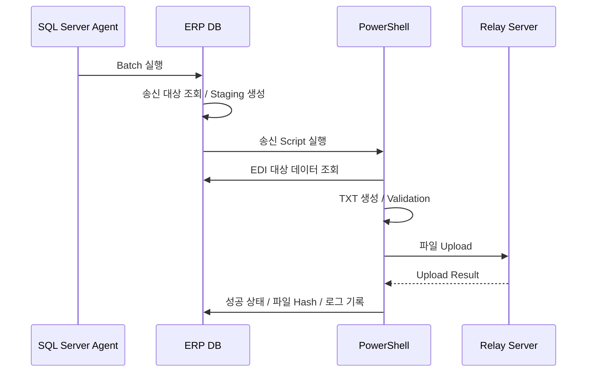
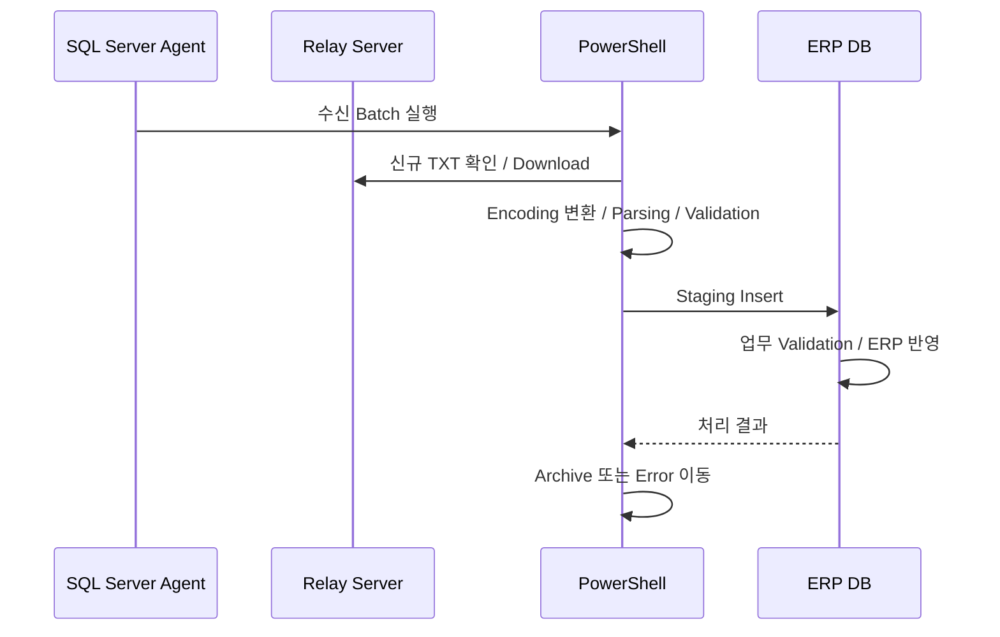

# ERP EDI Batch Integration

국내 ERP와 해외 본사 시스템 간 데이터를 정기적으로 송수신하기 위한 **File-based EDI Batch Integration** 포트폴리오 프로젝트입니다.

> 실제 기업 프로젝트에서 경험한 SQL Server Batch / Stored Procedure / PowerShell / 중계 서버 기반 EDI 연동 구조를 바탕으로 공개용으로 새로 설계했습니다. 실제 회사 소스코드, 내부 IP, 계정, 비밀번호, 테이블명, EDI 전문 규격 및 운영 서버 정보는 포함하지 않습니다.

## 프로젝트 핵심

- SQL Server Agent 기반 정기 Batch 실행
- Stored Procedure를 통한 송·수신 대상 데이터 조회 및 상태 관리
- PowerShell 기반 TXT 생성 / 업로드 / 다운로드 / Parsing
- Local Relay Mock과 FTP Adapter 분리
- 수신 파일 Encoding 변환 지원(UTF-8 / Shift-JIS 등)
- 파일 Hash 기반 중복 수신 방지
- 성공 / 실패 / 건수 / 파일명을 남기는 Integration Log
- 처리 완료 파일 Archive, 오류 파일 Error 영역 분리
- 송신 성공 후에만 ERP 전송 상태를 확정하는 흐름

## Architecture

```mermaid
flowchart LR
    A[SQL Server Agent] --> B[Stored Procedure]
    B --> C[PowerShell Integration]
    C --> D[TXT EDI File]
    D --> E[Relay Server]
    E --> F[HQ System]

    F --> G[Relay Server]
    G --> H[PowerShell Receiver]
    H --> I[Validation / Parsing]
    I --> J[Staging Table]
    J --> K[ERP Database]
```



공개 버전에서는 실제 중계 서버 대신 `relay/` 폴더를 사용하므로 외부 서버나 계정 없이 전체 흐름을 확인할 수 있습니다.

## 송신 Flow



## 수신 Flow



## 공개 Demo 구조

```text
erp-edi-batch-integration/
├─ database/
│  ├─ schema/                 # 공개용 Demo Table
│  ├─ procedures/             # 송·수신 Stored Procedure
│  └─ jobs/                   # SQL Server Agent 예시
├─ powershell/
│  ├─ Send-PurchaseOrder.ps1
│  ├─ Receive-ProductMaster.ps1
│  ├─ Run-Demo.ps1
│  └─ modules/
├─ relay/
│  ├─ outbound/               # 본사로 보낼 파일이 도착하는 Mock Relay
│  ├─ inbound/                # 본사에서 받은 파일을 두는 Mock Relay
│  ├─ archive/
│  └─ error/
├─ samples/
│  ├─ source/                 # Demo ERP 송신 데이터
│  ├─ inbound/                # Demo 본사 수신 데이터
│  └─ processed/
├─ docs/
├─ tools/
├─ config.demo.json
└─ config.example.json
```

## Demo 실행

### 요구사항

- PowerShell 7 권장 (`pwsh`)
- DB 없이도 Demo Mode 실행 가능
- 실제 SQL Server 연동 시 `SqlServer` PowerShell Module 필요

### 1. 전체 Demo

프로젝트 Root에서:

```powershell
pwsh ./powershell/Run-Demo.ps1
```

Windows PowerShell을 사용한다면:

```powershell
powershell -ExecutionPolicy Bypass -File .\powershell\Run-Demo.ps1
```

실행 후 다음을 확인합니다.

```text
relay/outbound/      # 송신 EDI TXT
relay/archive/       # 처리 완료 수신 파일
samples/processed/   # ERP 반영을 모사한 결과
logs/                # Batch 실행 로그
state/               # 처리 파일 Hash 기록
```

### 2. 송신만 실행

```powershell
pwsh ./powershell/Send-PurchaseOrder.ps1
```

### 3. 수신만 실행

```powershell
pwsh ./powershell/Receive-ProductMaster.ps1
```

## Demo EDI 전문

실제 기업 EDI 규격은 공개하지 않고 일반화한 Pipe-delimited 전문을 사용합니다.

### Purchase Order 송신

```text
PURCHASE_ORDER_NO|LINE_NO|ORDER_DATE|PRODUCT_CODE|QUANTITY|UNIT_PRICE|DELIVERY_DATE
PO-2026-0001|1|20260929|PRD-1001|10|125.50|20261005
```

### Product Master 수신

```text
PRODUCT_CODE|PRODUCT_NAME|REPLACEMENT_CODE|ACTIVE
PRD-1001|Digital Gauge A|PRD-2001|Y
```

상세 규격은 [`docs/file-specification.md`](docs/file-specification.md)를 참고하세요.

## SQL Server 연동

Demo Mode는 CSV와 Local Relay 폴더로 동작하지만, 실제 구조를 보여주기 위한 SQL Server Script도 함께 제공합니다.

- `database/schema/001_edi_tables.sql`
- `database/schema/002_demo_erp_tables.sql`
- `database/procedures/usp_edi_prepare_outbound_purchase_order.sql`
- `database/procedures/usp_edi_apply_inbound_product_master.sql`
- `database/procedures/usp_edi_write_log.sql`
- `database/jobs/sql_server_agent_examples.sql`

`config.example.json`을 복사해 실제 DB/Relay 환경값을 **환경변수 기반**으로 지정할 수 있습니다. Credential은 Repository에 저장하지 않습니다.

## 실제 프로젝트 경험과 공개 버전의 차이

실무 프로젝트에서는 SQL Server Batch와 Stored Procedure를 중심으로 PowerShell을 호출하여 중계 서버에 TXT 파일을 송수신했습니다. 공개 버전은 동일한 업무 흐름을 유지하면서 다음을 개선했습니다.

1. 운영 Credential과 서버 주소를 코드에서 완전히 분리
2. 실제 회사 EDI 전문 대신 일반화된 Demo 전문 사용
3. FTP 의존성을 `Relay Adapter`로 분리하여 Local Mock 실행 지원
4. 파일 SHA-256을 이용한 중복 수신 방지
5. Archive / Error 영역을 분리하여 재처리 가능성 확보
6. 송·수신 공통 로그와 실행 결과를 표준화
7. 실제 파일 전송 성공 이후에만 ERP 송신 상태 확정

## Portfolio에서 보여주는 역량

- ERP Batch 업무 설계
- SQL Server Stored Procedure 및 Transaction 처리
- PowerShell Automation
- File-based EDI / B2B Integration
- FTP / Relay Server 연동
- Character Encoding 처리
- 장애 / 재처리 / 중복 방지 설계
- Legacy Integration 운영 경험

## 문서

- [Architecture](docs/architecture.md)
- [송신 처리](docs/outbound-flow.md)
- [수신 처리](docs/inbound-flow.md)
- [EDI 파일 규격](docs/file-specification.md)
- [운영 및 장애 복구](docs/operations-and-recovery.md)
- [공개용 재구성 원칙](docs/public-rebuild.md)
- [Reviewer Guide](docs/reviewer-guide.md)

## Security

실제 프로젝트 원본에는 내부 서버 주소와 전송 Credential이 포함되어 있었기 때문에 공개 Repository에는 원본 파일을 포함하지 않습니다. 자세한 내용은 [`SECURITY.md`](SECURITY.md)를 참고하세요.
